# Giao diện Hermes Clip: từng mục và chức năng
Ảnh chụp từ bản app chạy **cách ly** (dữ liệu trống + sản phẩm mẫu `TEST LOCAL`, chặn mạng, không có tài khoản hay dữ liệu thật), nên màn Muse hiện "đang tạm dừng" và nhiều bảng trống. Ngày chụp: 16/11/2026, cửa sổ 1366 px. Mô tả chức năng dựa trên nhãn hiện trên màn hình và mã nguồn; chỗ nào chưa bấm thử thì chỉ ghi nhãn, không đoán thêm.
Thanh bên chính (9 mục): Tín hiệu & Phòng chờ, Hôm nay, Săn sản phẩm, Sản phẩm, Video, Nhân vật, Đăng, Kết quả, Cài đặt. Mục **Nâng cao** (12 mục còn lại) hiện khi bật "Hiện màn nâng cao" trong Cài đặt.

## 1. Tín hiệu & Phòng chờ

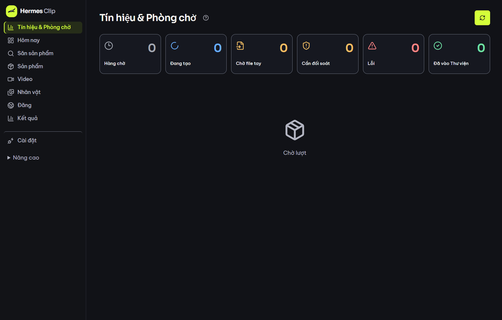

Bảng điều khiển nhanh: đếm Hàng chờ, Đang tạo, Chờ file tay, Cần đối soát, Lỗi, Đã vào Thư viện. Chỗ đầu tiên nhìn để biết Muse có đang chặn việc không.
Nút/nhãn thấy trên màn: `Làm mới`, `0 Hàng chờ`, `0 Đang tạo`, `0 Chờ file tay`, `0 Cần đối soát`, `0 Lỗi`, `0 Đã vào Thư viện`, `01 · Hook · Which pocket?3s`, `02 · Body · Waist-worn pouch3s`, `03 · Body · Open reach close3s`, `04 · CTA · Check the details3s`, `Tạo bằng Muse`.

## 2. Hôm nay

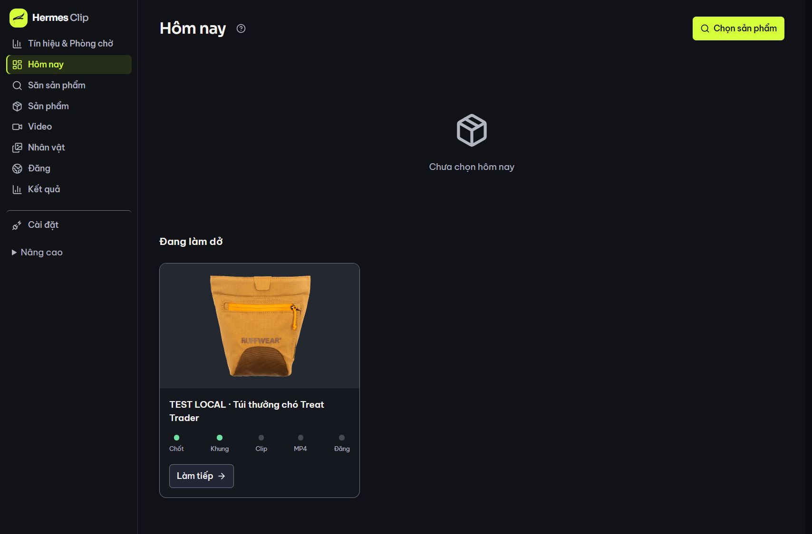

"Hôm nay": việc nên làm trong ngày (sản phẩm nào đang chạy, bước kế tiếp).
Nút/nhãn thấy trên màn: `Chọn sản phẩm`, `Làm tiếp`, `01 · Hook · Which pocket?3s`, `02 · Body · Waist-worn pouch3s`, `03 · Body · Open reach close3s`, `04 · CTA · Check the details3s`, `Tạo bằng Muse`, `Xuất gói prompt`, `Mở hộp nhận media`, `Cấu hình`, `Hàng đợi (4)`, `Xem trước`.

## 3. Săn sản phẩm

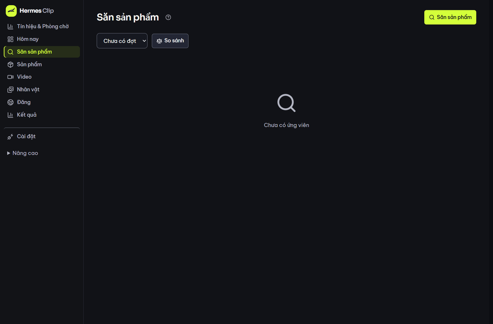

"Săn sản phẩm": chạy đợt tìm ứng viên, so sánh ứng viên, kiểm giá/nguồn.
Nút/nhãn thấy trên màn: `Săn sản phẩm`, `So sánh`, `01 · Hook · Which pocket?3s`, `02 · Body · Waist-worn pouch3s`, `03 · Body · Open reach close3s`, `04 · CTA · Check the details3s`, `Tạo bằng Muse`, `Xuất gói prompt`, `Mở hộp nhận media`, `Cấu hình`, `Hàng đợi (4)`, `Xem trước`.

## 4. Sản phẩm

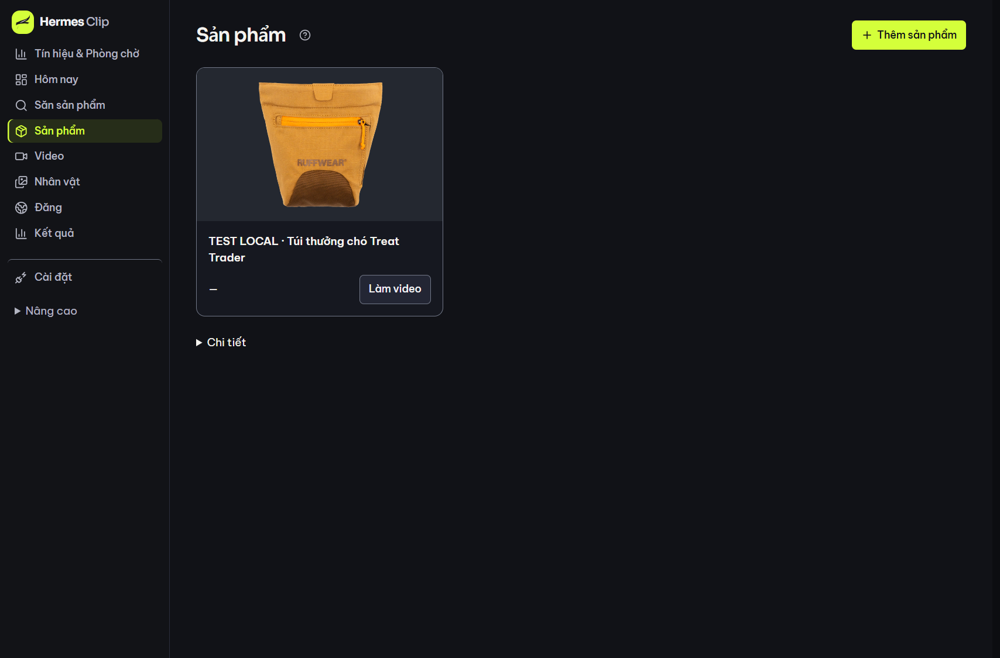

Danh sách sản phẩm và hồ sơ từng sản phẩm (tên thương hiệu, từ khóa CTA, đối tượng, tình huống mở đầu…).
Nút/nhãn thấy trên màn: `Thêm sản phẩm`, `TEST LOCAL · Túi thưởng chó Treat Trader`, `Làm video`, `Gán mã và tự xếp hạng`, `Làm video cho sản phẩm này`, `Lưu trữ TEST LOCAL · Túi thưởng chó Treat Trader`, `Trang trước`, `Trang sau`, `01 · Hook · Which pocket?3s`, `02 · Body · Waist-worn pouch3s`, `03 · Body · Open reach close3s`, `04 · CTA · Check the details3s`.

## 5. Video

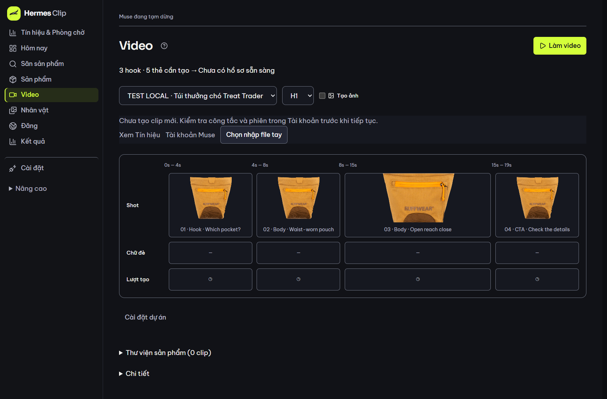

"Video": chọn sản phẩm và hook (H1…), xem bảng khung (shot, chữ đè, lượt tạo) rồi bấm "Làm video" hoặc "Chọn nhập file tay".
Nút/nhãn thấy trên màn: `Làm video`, `Xem Tín hiệu`, `Chọn nhập file tay`, `01 · Hook · Which pocket?3s`, `02 · Body · Waist-worn pouch3s`, `03 · Body · Open reach close3s`, `04 · CTA · Check the details3s`, `Tạo bằng Muse`, `Xuất gói prompt`, `Mở hộp nhận media`, `Cấu hình`, `Hàng đợi (4)`.

## 6. Nhân vật

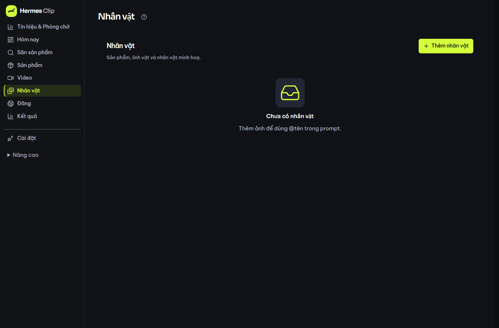

"Nhân vật": thư viện nhân vật dùng lại giữa các video.
Nút/nhãn thấy trên màn: `Thêm nhân vật`, `01 · Hook · Which pocket?3s`, `02 · Body · Waist-worn pouch3s`, `03 · Body · Open reach close3s`, `04 · CTA · Check the details3s`, `Tạo bằng Muse`, `Xuất gói prompt`, `Mở hộp nhận media`, `Cấu hình`, `Hàng đợi (4)`, `Xem trước`, `Khung content`.

## 7. Đăng

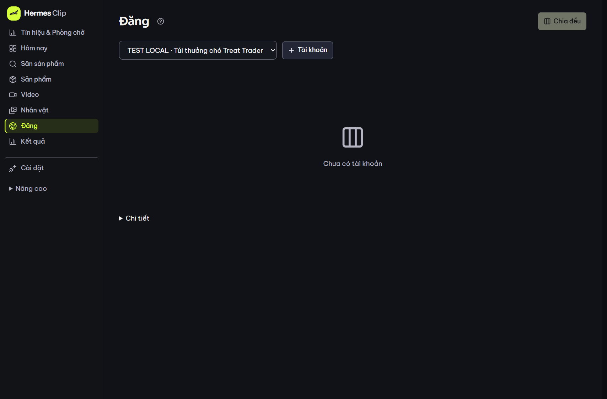

"Đăng": chia đều bài đăng cho các tài khoản Instagram, duyệt trước khi đăng.
Nút/nhãn thấy trên màn: `Chia đều`, `Tài khoản`, `01 · Hook · Which pocket?3s`, `02 · Body · Waist-worn pouch3s`, `03 · Body · Open reach close3s`, `04 · CTA · Check the details3s`, `Tạo bằng Muse`, `Xuất gói prompt`, `Mở hộp nhận media`, `Cấu hình`, `Hàng đợi (4)`, `Xem trước`.

## 8. Kết quả

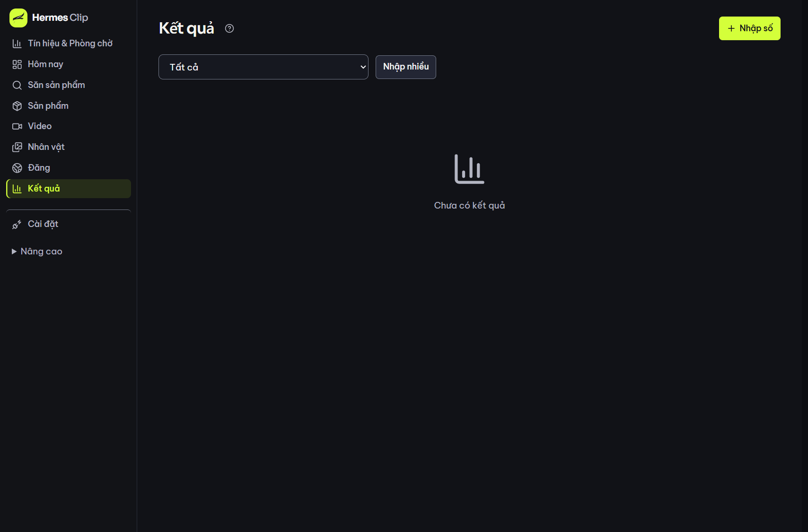

"Kết quả": số liệu sau đăng (lượt xem, comment từ khóa) để quyết định giữ hay bỏ.
Nút/nhãn thấy trên màn: `Nhập số`, `Nhập nhiều`, `01 · Hook · Which pocket?3s`, `02 · Body · Waist-worn pouch3s`, `03 · Body · Open reach close3s`, `04 · CTA · Check the details3s`, `Tạo bằng Muse`, `Xuất gói prompt`, `Mở hộp nhận media`, `Cấu hình`, `Hàng đợi (4)`, `Xem trước`.

## 9. Hướng dẫn

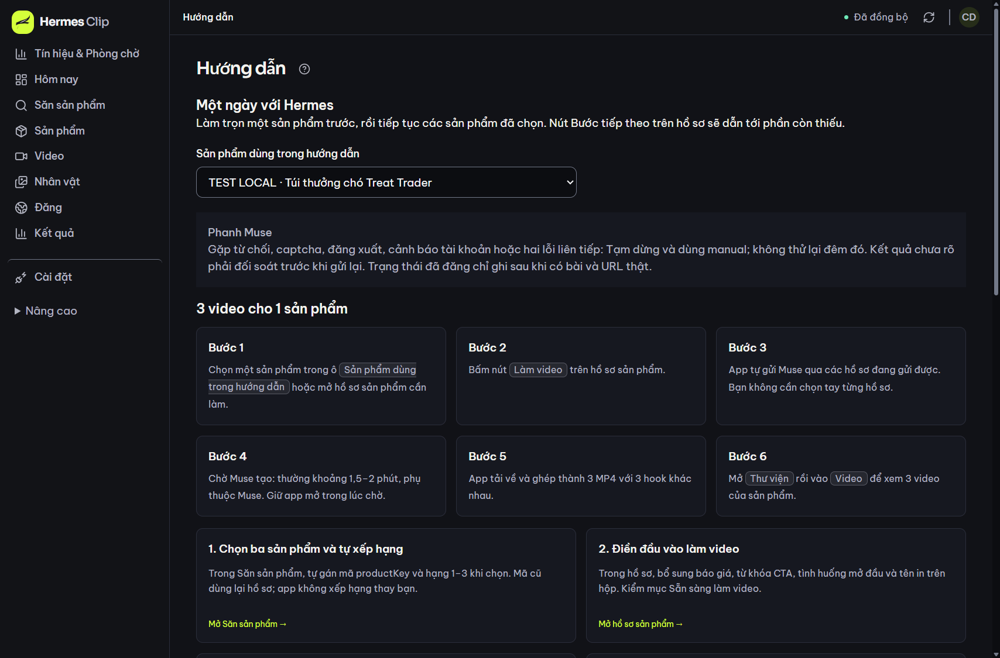

"Hướng dẫn": các bước dùng app, có chỉ dẫn từng mục.
Nút/nhãn thấy trên màn: `Mở Săn sản phẩm →`, `Mở hồ sơ sản phẩm →`, `Mở Khung content →`, `Mở gói tạo bằng Muse →`, `Mở xuất gói prompt →`, `Mở Hộp nhận trong Tạo media →`, `Mở chọn đoạn →`, `Mở Ghép và xuất →`, `Mở nhóm ba hook →`, `Mở tạo bài nháp →`, `Mở bài Instagram →`, `Mở nhập số liệu →`.

## 10. Cài đặt

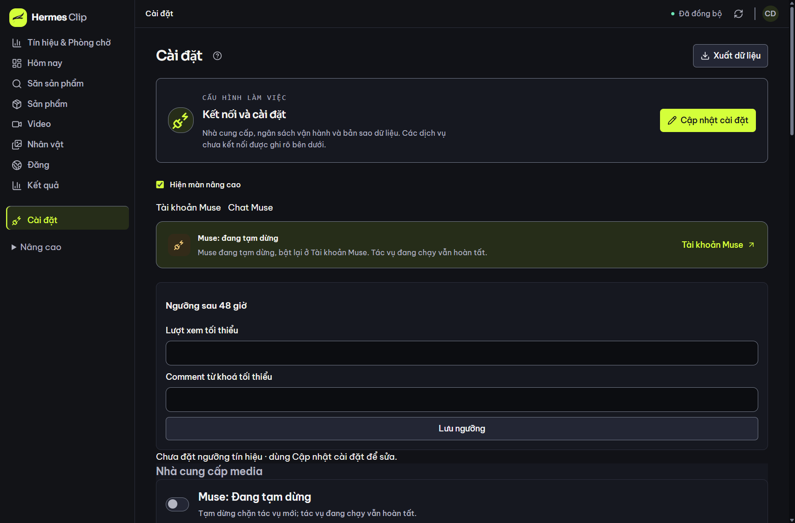

"Cài đặt": kết nối, ngưỡng tín hiệu, giãn nhịp gói Muse, hộp nhận media, cấu hình Codex CLI, tắt khẩn cấp DM. Có công tắc "Hiện màn nâng cao".
Nút/nhãn thấy trên màn: `Xuất dữ liệu`, `Cập nhật cài đặt`, `Lưu ngưỡng`, `Lưu giãn nhịp`, `Lưu hộp nhận media`, `Lưu cấu hình Codex CLI`, `Lưu cách đọc ảnh`, `Kiểm tra rea-video và cờ Codex`, `Cấu hình Gemini trên máy`, `Tắt khẩn cấp mọi DM`, `Quản lý tài khoản Muse`, `Ghi khoản chi`.

## 11. Khung content

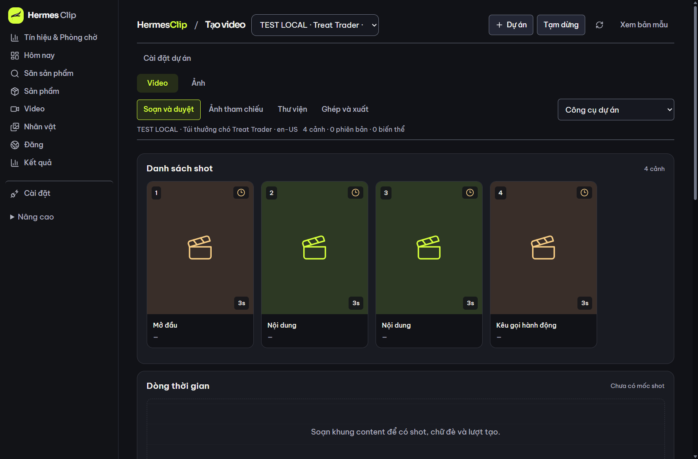

"Khung content" (Nâng cao): các công thức hook/khung nội dung.
Nút/nhãn thấy trên màn: `1 3s Mở đầu —`, `2 3s Nội dung —`, `3 3s Nội dung —`, `4 3s Kêu gọi hành động —`, `Tạo bằng Muse`, `Xuất gói prompt`, `Mở hộp nhận media`, `Cấu hình`, `Hàng đợi (4)`, `Xem trước`, `Khung content`, `Muse đang tạm dừng`.

## 12. Đối thủ & video

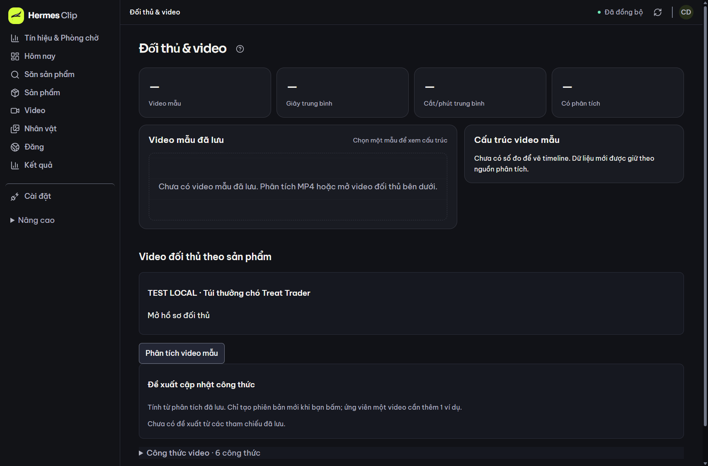

"Đối thủ & video" (Nâng cao): mở hồ sơ đối thủ, phân tích video mẫu.
Nút/nhãn thấy trên màn: `Mở hồ sơ đối thủ`, `Phân tích video mẫu`, `01 · Hook · Which pocket?3s`, `02 · Body · Waist-worn pouch3s`, `03 · Body · Open reach close3s`, `04 · CTA · Check the details3s`, `Tạo bằng Muse`, `Xuất gói prompt`, `Mở hộp nhận media`, `Cấu hình`, `Hàng đợi (4)`, `Xem trước`.

## 13. Phòng sản xuất

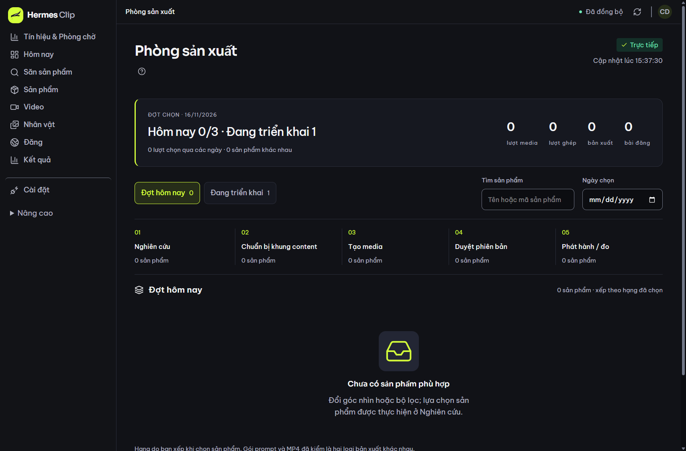

"Phòng sản xuất" (Nâng cao): bảng soạn và duyệt các thẻ sản xuất.
Nút/nhãn thấy trên màn: `Đợt hôm nay 0`, `Đang triển khai 1`, `01 · Hook · Which pocket?3s`, `02 · Body · Waist-worn pouch3s`, `03 · Body · Open reach close3s`, `04 · CTA · Check the details3s`, `Tạo bằng Muse`, `Xuất gói prompt`, `Mở hộp nhận media`, `Cấu hình`, `Hàng đợi (4)`, `Xem trước`.

## 14. Tạo ảnh

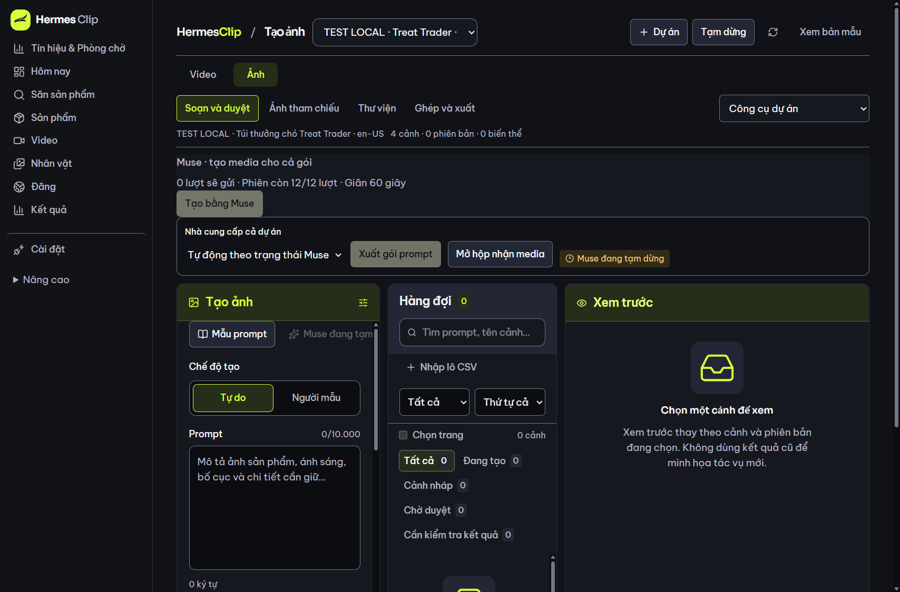

"Tạo ảnh" (Nâng cao): tạo ảnh tham chiếu/ảnh sản phẩm.
Nút/nhãn thấy trên màn: `Tạo bằng Muse`, `Xuất gói prompt`, `Mở hộp nhận media`, `Cấu hình`, `Hàng đợi (0)`, `Xem trước`, `Mẫu prompt`, `Muse đang tạm dừng`, `Tự do`, `Người mẫu`, `Thêm ảnh tham chiếu Chọn file · JPG, PNG, WebP · tối đa 8 MB`, `9:16`.

## 15. Hàng đợi

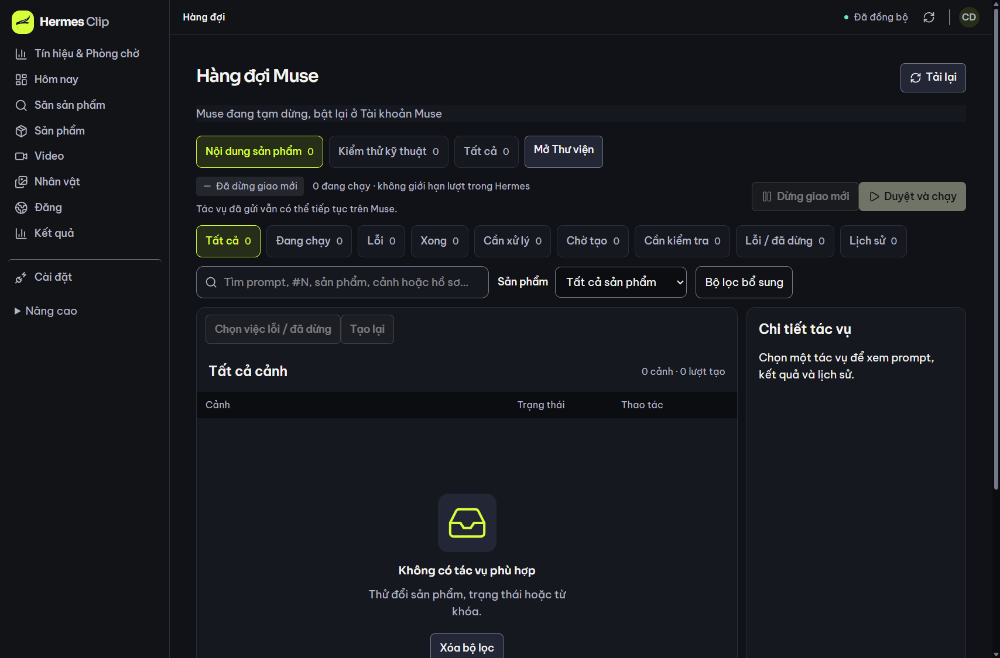

"Hàng đợi" (Nâng cao): ý tưởng và hàng đợi tạo clip, tạo 6 khung từ khung content.
Nút/nhãn thấy trên màn: `Tải lại`, `Nội dung sản phẩm 0`, `Kiểm thử kỹ thuật 0`, `Tất cả 0`, `Mở Thư viện`, `Dừng giao mới`, `Duyệt và chạy`, `Đang chạy 0`, `Lỗi 0`, `Xong 0`, `Cần xử lý 0`, `Chờ tạo 0`.

## 16. Chat Muse

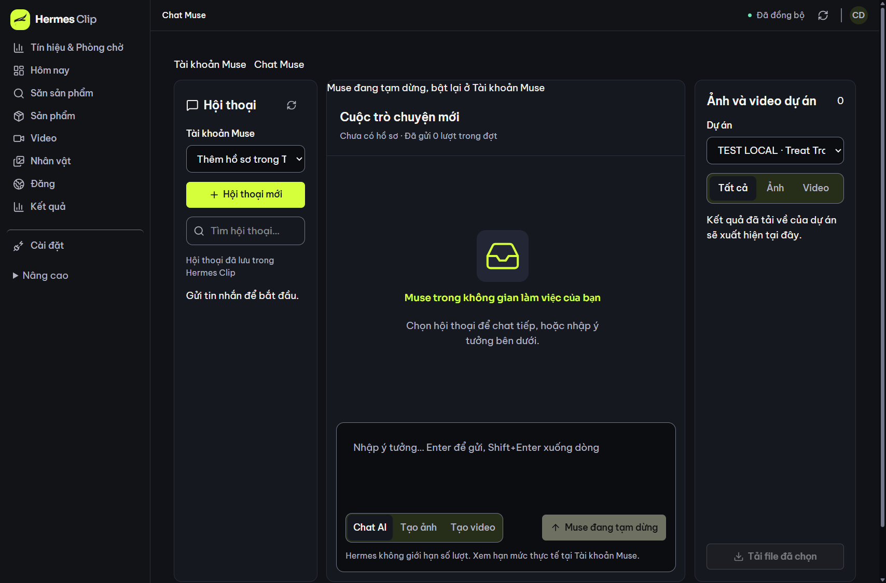

"Chat Muse" (Nâng cao): hội thoại với Muse, lọc Tất cả/Ảnh/Video, tải file đã chọn.
Nút/nhãn thấy trên màn: `01 · Hook · Which pocket?3s`, `02 · Body · Waist-worn pouch3s`, `03 · Body · Open reach close3s`, `04 · CTA · Check the details3s`, `Tạo bằng Muse`, `Xuất gói prompt`, `Mở hộp nhận media`, `Cấu hình`, `Hàng đợi (4)`, `Xem trước`, `Khung content`, `Muse đang tạm dừng`.

## 17. Thư viện

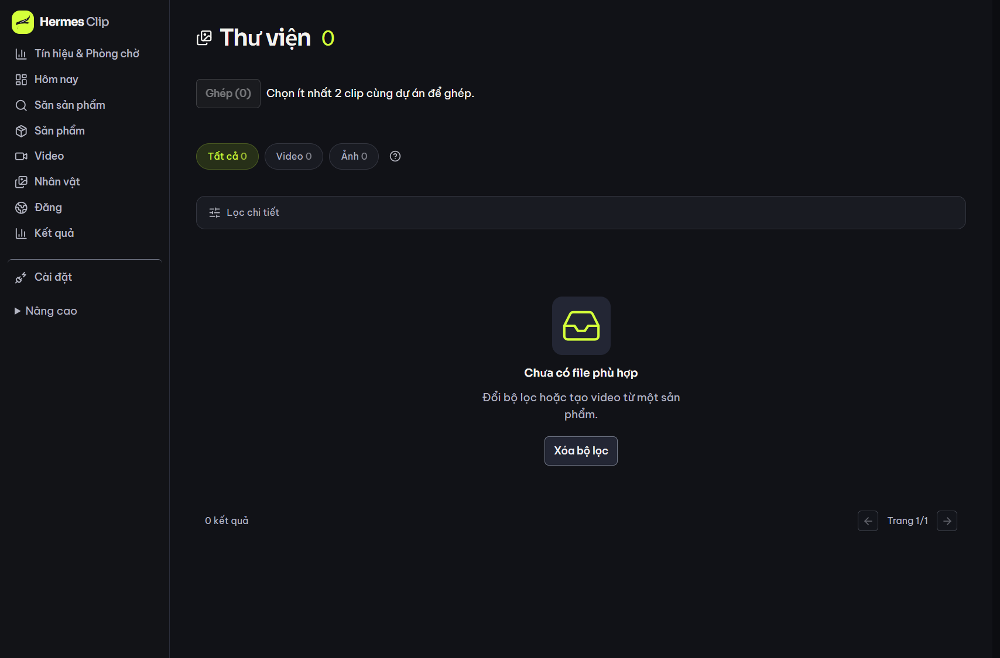

"Thư viện" (Nâng cao): clip và ảnh đã tạo, lọc, ghép, xóa bộ lọc.
Nút/nhãn thấy trên màn: `Ghép (0)`, `Tất cả 0`, `Video 0`, `Ảnh 0`, `Xóa bộ lọc`, `Trang trước`, `Trang sau`, `01 · Hook · Which pocket?3s`, `02 · Body · Waist-worn pouch3s`, `03 · Body · Open reach close3s`, `04 · CTA · Check the details3s`, `Tạo bằng Muse`.

## 18. Tài khoản Muse

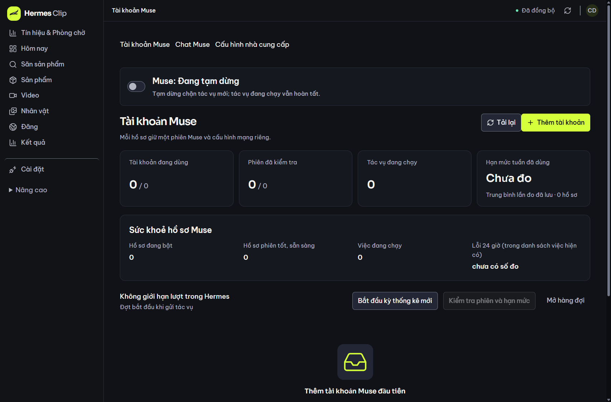

"Tài khoản Muse" (Nâng cao): hồ sơ Muse, công tắc từng hồ sơ, tạm dừng/bật lại, đối soát.
Nút/nhãn thấy trên màn: `Cấu hình nhà cung cấp`, `Tải lại`, `Thêm tài khoản`, `Bắt đầu kỳ thống kê mới`, `Kiểm tra phiên và hạn mức`, `Mở hàng đợi`, `01 · Hook · Which pocket?3s`, `02 · Body · Waist-worn pouch3s`, `03 · Body · Open reach close3s`, `04 · CTA · Check the details3s`, `Tạo bằng Muse`, `Xuất gói prompt`.

## 19. Ý tưởng đã lưu

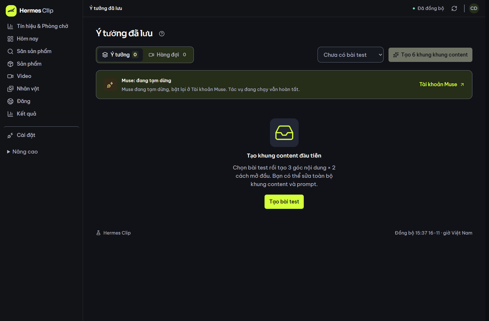

"Ý tưởng đã lưu" (Nâng cao): kho ý tưởng/kịch bản đã lưu.
Nút/nhãn thấy trên màn: `Ý tưởng 0`, `Hàng đợi 0`, `Tạo 6 khung khung content`, `Tạo bài test`, `01 · Hook · Which pocket?3s`, `02 · Body · Waist-worn pouch3s`, `03 · Body · Open reach close3s`, `04 · CTA · Check the details3s`, `Tạo bằng Muse`, `Xuất gói prompt`, `Mở hộp nhận media`, `Cấu hình`.

## 20. Quyết định

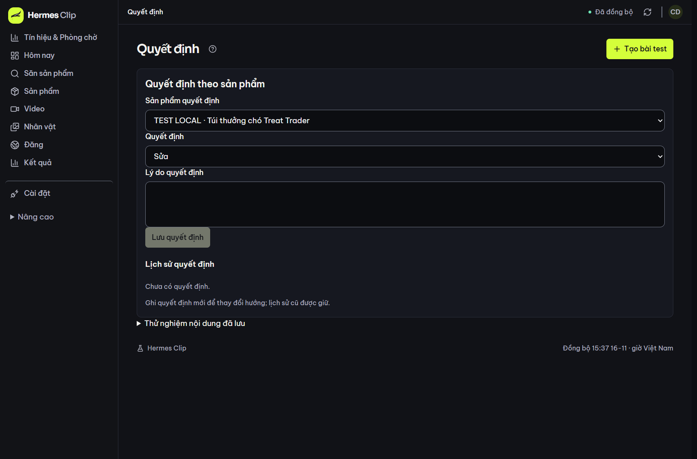

"Quyết định" (Nâng cao): tạo bài test và lưu quyết định giữ/bỏ.
Nút/nhãn thấy trên màn: `Tạo bài test`, `Lưu quyết định`, `Trang trước`, `Trang sau`, `01 · Hook · Which pocket?3s`, `02 · Body · Waist-worn pouch3s`, `03 · Body · Open reach close3s`, `04 · CTA · Check the details3s`, `Tạo bằng Muse`, `Xuất gói prompt`, `Mở hộp nhận media`, `Cấu hình`.

## 21. Trang giới thiệu

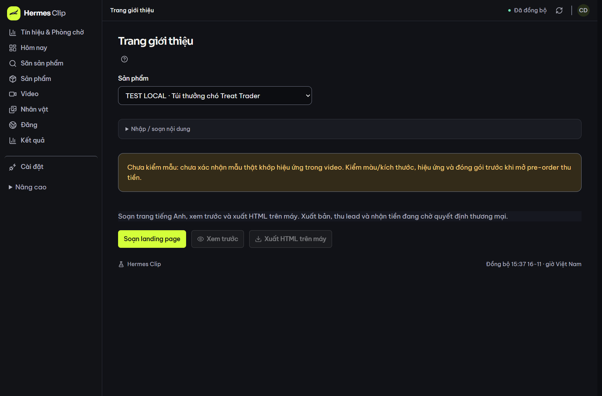

"Trang giới thiệu" (Nâng cao): nội dung trang bán/giới thiệu sản phẩm.
Nút/nhãn thấy trên màn: `Soạn landing page`, `Xem trước`, `Xuất HTML trên máy`, `01 · Hook · Which pocket?3s`, `02 · Body · Waist-worn pouch3s`, `03 · Body · Open reach close3s`, `04 · CTA · Check the details3s`, `Tạo bằng Muse`, `Xuất gói prompt`, `Mở hộp nhận media`, `Cấu hình`, `Hàng đợi (4)`.
